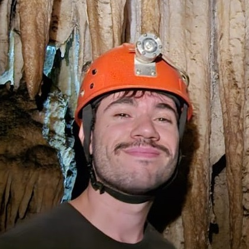

:::::: columnsABC
::: column1
{#profile-pic .rounded .shadow fig-align="left"} [jp.donadio\@gmail.com](mailto:jp.donadio@gmail.com)\
[LinkedIn](https://www.linkedin.com/in/joaopdonadio)\
[GitHub](https://github.com/DonadioJP)\
[ORCID](https://orcid.org/0000-0002-6728-4373)\
[English version](index.qmd){.lang-link}
:::

:::: column2
::: bio-box
**Olá, eu sou João Pedro Donadio**, engenheiro agrônomo e doutorando na Lincoln University, Nova Zelândia.

Trabalho onde a pesquisa de campo encontra a análise de dados. Planejo experimentos, coleto dados nas propriedades e os transformo em respostas claras e práticas. Meu foco é bem-estar animal, comportamento de bovinos e sistemas de produção animal sustentáveis e agroecológicos.

Me vejo como **cientista, profissional de campo e criador de conteúdo**: faço a pesquisa, conheço o dia a dia da propriedade e construo as ferramentas que levam o que aprendemos às mãos de quem precisa.
:::
::::
::::::

```{r}
#| echo: false
library(htmltools)

pillar <- function(title, text, link_text, href) {
  div(class = "pillar",
      h3(title, class = "pillar-title"),
      p(text),
      a(link_text, href = href, class = "pillar-link"))
}

div(class = "pillars",
  pillar("Cientista",
         "Pesquisa revisada por pares sobre bem-estar, comportamento e alojamento de bezerras leiteiras, do delineamento experimental à meta-análise e modelagem estatística em R.",
         "Publicações →", "publications.qmd"),
  pillar("Profissional de campo",
         "Anos de campo na América Latina, trabalhando com manejo agroecológico de pastagens na bovinocultura de corte e de leite e na ovinocultura.",
         "Experiência →", "cv.qmd"),
  pillar("Criador de conteúdo",
         "Ferramentas que colocam a pesquisa para trabalhar: um portal aberto sobre criação animal agroecológica, calculadoras em Shiny, painéis e relatórios reprodutíveis.",
         "Projetos →", "projects.qmd")
)
```

```{r}
#| echo: false
div(style = "position: relative; height: 100px; text-align: center;",
    a(href = "cv.qmd", class = "cv-button-box", "Quer saber mais? Acesse meu CV"))
```

```{r}
#| echo: false
divider <- function(thick = FALSE) {
  tags$hr(class = ifelse(thick, "section-divider thick", "section-divider"))
}
divider()
```

::: Portfolio
### Destaques

```{r}
#| echo: false
featured_item <- function(theme, title, date, src, alt, href = NULL, external = FALSE) {
  image <- img(src = src, class = "portfolio-image", alt = alt)
  div(class = "portfolio-item",
      if (is.null(href)) image else
        a(href = href, target = if (external) "_blank" else NULL, image),
      p(class = "portfolio-theme", theme),
      h3(class = "portfolio-title", title),
      p(class = "portfolio-date", date))
}

div(class = "portfolio-gallery",
  featured_item("Criador de conteúdo · Site", "Criação Animal Agroecológica", "2026",
                "images/caa_preview.jpg", "Página inicial do portal Criação Animal Agroecológica",
                href = "https://donadiojp.github.io/caa/", external = TRUE),
  featured_item("Cientista · Pesquisa", "Água e Sombra para Bovinos a Pasto",
                "Artigo em preparação",
                "images/water_shade.jpg", "Vacas pastando sob árvores"),
  featured_item("Cientista · Publicação", "Bebedouros com Bico Reduzem a Mamada Cruzada em Bezerras",
                "Applied Animal Behaviour Science, 2025",
                "images/Calves_water.png", "Bezerras em um bebedouro",
                href = "watercalves.qmd")
)

div(class = "portfolio-item see-more-button",
    a(href = "projects.qmd", class = "portfolio-button",
      span("Ver todos os projetos"),
      div(class = "button-icon", "+")))
```
:::

```{r}
#| echo: false
divider()
```

::: contact
### Contato ✉️ {#contact}
:::

```{r}
#| echo: false
field <- function(id, label, input) {
  tags$div(class = "form-group",
           tags$label(`for` = id, class = "form-label", label),
           input)
}

tags$div(
  class = "contact-form",
  tags$form(
    action = "https://formspree.io/f/xjkwbbgg",
    method = "POST",
    field("name", "Nome",
          tags$input(type = "text", class = "form-control", id = "name", name = "name", required = NA)),
    field("email", "E-mail",
          tags$input(type = "email", class = "form-control", id = "email", name = "_replyto", required = NA)),
    field("message", "Mensagem",
          tags$textarea(class = "form-control", id = "message", name = "message", required = NA)),
    tags$div(class = "form-group btn-container",
             tags$button(type = "submit", class = "btn btn-primary", "Enviar"))
  )
)
```
