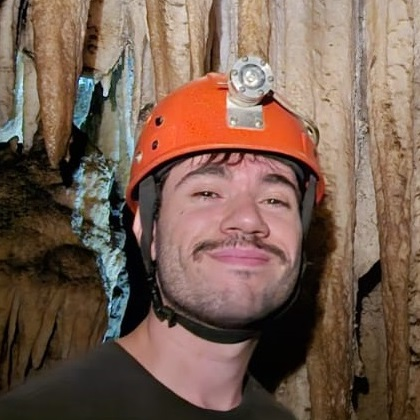

:::::: columnsABC
::: column1
{#profile-pic .rounded .shadow fig-align="left"} [jp.donadio\@gmail.com](mailto:jp.donadio@gmail.com)\
[LinkedIn](https://www.linkedin.com/in/joaopdonadio)\
[GitHub](https://github.com/DonadioJP)\
[ORCID](https://orcid.org/0000-0002-6728-4373)\
[Versão em português](index.pt.qmd){.lang-link}
:::

:::: column2
::: bio-box
**Hi, I'm João Pedro Donadio**, an agricultural engineer and PhD student at Lincoln University, New Zealand.

I work where field research meets data analysis. I design experiments, collect data on farms, and turn it into clear, practical insight. My work focuses on animal welfare, cattle behaviour and sustainable, agroecological livestock systems.

I think of myself as a **scientist, practitioner and science communicator**: I do the research, I know the day-to-day reality of the farm, and I turn what we learn into knowledge people can use.
:::
::::
::::::

```{r}
#| echo: false
library(htmltools)

pillar <- function(title, text, link_text, href) {
  div(class = "pillar",
      h3(title, class = "pillar-title"),
      p(text),
      a(link_text, href = href, class = "pillar-link"))
}

div(class = "pillars",
  pillar("Scientist",
         "Peer-reviewed research on dairy calf welfare, behaviour and housing, from experimental design to meta-analysis and statistical modelling in R.",
         "Publications →", "publications.qmd"),
  pillar("Practitioner",
         "Years in the field across Latin America, working on agroecological pasture management with beef cattle, dairy cattle and sheep.",
         "Experience →", "cv.qmd"),
  pillar("Science Communicator",
         "Turning research into accessible knowledge: an open portal on agroecological animal production, with practical guides, lessons, field notes and interactive calculators.",
         "Projects →", "projects.qmd")
)
```

```{r}
#| echo: false
div(style = "position: relative; height: 100px; text-align: center;",
    a(href = "cv.qmd", class = "cv-button-box", "Want to know more? Access my CV"))
```

```{r}
#| echo: false
divider <- function(thick = FALSE) {
  tags$hr(class = ifelse(thick, "section-divider thick", "section-divider"))
}
divider()
```

::: Portfolio
### Featured work

```{r}
#| echo: false
featured_item <- function(theme, title, date, src, alt, href = NULL, external = FALSE) {
  image <- img(src = src, class = "portfolio-image", alt = alt)
  div(class = "portfolio-item",
      if (is.null(href)) image else
        a(href = href, target = if (external) "_blank" else NULL, image),
      p(class = "portfolio-theme", theme),
      h3(class = "portfolio-title", title),
      p(class = "portfolio-date", date))
}

div(class = "portfolio-gallery",
  featured_item("Science Communication · Website", "Criação Animal Agroecológica", "2026",
                "images/caa_preview.jpg", "Criação Animal Agroecológica homepage",
                href = "https://donadiojp.github.io/caa/", external = TRUE),
  featured_item("Scientist · Research", "Water & Shade for Grazing Cattle",
                "Manuscript in preparation",
                "images/water_shade.jpg", "Cows grazing under trees"),
  featured_item("Scientist · Publication", "Nipple Water Troughs Reduce Cross-Sucking in Calves",
                "Applied Animal Behaviour Science, 2025",
                "images/Calves_water.png", "Calves at a water trough",
                href = "watercalves.qmd")
)

div(class = "portfolio-item see-more-button",
    a(href = "projects.qmd", class = "portfolio-button",
      span("View All Projects"),
      div(class = "button-icon", "+")))
```
:::

```{r}
#| echo: false
divider()
```

::: contact
### Contact me ✉️ {#contact}
:::

```{r}
#| echo: false
field <- function(id, label, input) {
  tags$div(class = "form-group",
           tags$label(`for` = id, class = "form-label", label),
           input)
}

tags$div(
  class = "contact-form",
  tags$form(
    action = "https://formspree.io/f/xjkwbbgg",
    method = "POST",
    field("name", "Name",
          tags$input(type = "text", class = "form-control", id = "name", name = "name", required = NA)),
    field("email", "Email",
          tags$input(type = "email", class = "form-control", id = "email", name = "_replyto", required = NA)),
    field("message", "Message",
          tags$textarea(class = "form-control", id = "message", name = "message", required = NA)),
    tags$div(class = "form-group btn-container",
             tags$button(type = "submit", class = "btn btn-primary", "Send"))
  )
)
```
